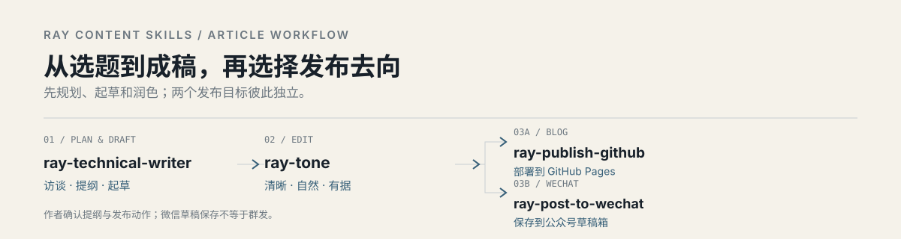

# Ray Content Skills

**Five Ray content skills plus the upstream Lieflat submodule for Chinese technical writing, editing, and publishing to GitHub Pages or WeChat.**

Use the skills individually, or follow the path below. They help structure the article and its evidence; they do not replace the author's judgment or publish without an explicit request.

<p align="center">
  
</p>

## Workflow

| Stage | Skill | What it does |
|---|---|---|
| Plan and draft | [`ray-technical-writer`](skills/ray-technical-writer/SKILL.md) | Builds a reviewable outline and writes a Chinese technical blog or WeChat article, then coordinates the editing steps below. |
| Polish | [`ray-tone`](skills/ray-tone/SKILL.md) | Improves clarity and natural flow while preserving supported facts, uncertainty, and author intent. |
| Check the finished draft | [`lieflat-less-ai-tone`](skills/lieflat-less-ai-tone/SKILL.md) | Reports scripted and semantic findings, proposes edits, and applies accepted changes before rechecking and showing the differences. |
| Write Obsidian notes | [`ray-obsidian-markdown`](skills/ray-obsidian-markdown/SKILL.md) | Creates and edits Obsidian Markdown with wikilinks, embeds, callouts, properties, and other vault syntax. |
| Publish to a blog | [`ray-publish-github`](skills/ray-publish-github/SKILL.md) | Adapts the article for a Jekyll GitHub Pages site, pushes only with authorization, and verifies the live post. |
| Save to WeChat | [`ray-post-to-wechat`](skills/ray-post-to-wechat/SKILL.md) | Renders Markdown and saves an article to the Official Account draft box via API or browser. |

The two publishing skills are separate endpoints. GitHub Pages publication does not publish to WeChat, and saving a WeChat draft does not send it to readers. The WeChat skill's browser or API setup depends on the account and local environment.

## Install

Clone the repository, then copy the skills you want into your Codex skills directory:

```bash
git clone --recurse-submodules https://github.com/huruizhi/ray-content-skills.git
cd ray-content-skills
cp -R skills/ray-technical-writer ~/.codex/skills/
cp -R skills/ray-tone ~/.codex/skills/
mkdir -p ~/.codex/skills/lieflat-less-ai-tone
rsync -a --exclude=.git skills/lieflat-less-ai-tone/ ~/.codex/skills/lieflat-less-ai-tone/
cp -R skills/ray-obsidian-markdown ~/.codex/skills/
cp -R skills/ray-publish-github ~/.codex/skills/
cp -R skills/ray-post-to-wechat ~/.codex/skills/
```

For an existing checkout, run `git submodule update --init --recursive` first. Install `ray-technical-writer`, `ray-tone`, and `lieflat-less-ai-tone` together for the complete writing workflow. Lieflat requires Python 3 and its bundled scripts and references; keep its license with the installation. The submodule pins the upstream version rather than copying its rules into Ray skills.

Restart or refresh the Codex session if it does not discover the new skills immediately.

## Use

Invoke a skill by name:

```text
$ray-technical-writer 帮我把这个技术主题整理成文章提纲
$ray-tone 润色这篇草稿
$lieflat-less-ai-tone 检查这篇中文成稿，先给出检测结果和修改建议
$ray-obsidian-markdown 帮我整理这篇 Obsidian 笔记并补齐内部链接
$ray-publish-github 把已确认的文章适配并发布到 GitHub Pages
$ray-post-to-wechat 把文章保存到公众号草稿箱
```

For a substantial new article, `ray-technical-writer` presents an outline for review before drafting. Wording-only revisions use the existing draft's structure as the agreed scope. Drafting is followed by ray-tone editing and Lieflat detection; the user reviews cleanup suggestions before the accepted edits, recheck, and final save. Metadata, link, and asset-path fixes alone do not trigger this editorial workflow. The publishing skills keep their own authorization and verification steps; a draft, a deployed blog post, and a WeChat mass-send are distinct outcomes.

## Contents and attribution

- `skills/ray-technical-writer/` — article planning and drafting.
- `skills/ray-tone/` — editorial guidance and an optional tone lint script.
- `skills/lieflat-less-ai-tone/` — upstream [larashero3-dotcom/lieflat-less-ai-tone](https://github.com/larashero3-dotcom/lieflat-less-ai-tone), tracked as a Git submodule with its scripts, references, and license intact.
- `skills/ray-obsidian-markdown/` — Obsidian Flavored Markdown reference and authoring workflow.
- `skills/ray-publish-github/` — Jekyll Pages publishing guidance and a live-site verification script.
- `skills/ray-post-to-wechat/` — WeChat article guidance, scripts, and setup references.

`ray-post-to-wechat` is adapted from [JimLiu/baoyu-skills](https://github.com/JimLiu/baoyu-skills). It retains the upstream MIT license in its skill directory and uses upstream dependencies and compatible Baoyu configuration locations.

Credentials, browser profiles, and account-specific configuration belong in local environment variables or ignored configuration files. Do not commit them.

Ray-authored skill content has no blanket license. The MIT license in `skills/ray-post-to-wechat/LICENSE` applies to the upstream material covered by that license.

Lieflat is separately licensed under [CC BY-NC 4.0](skills/lieflat-less-ai-tone/LICENSE); its author requests contact for commercial licensing. Its inclusion does not relicense the Ray-authored skills or the WeChat upstream material.
